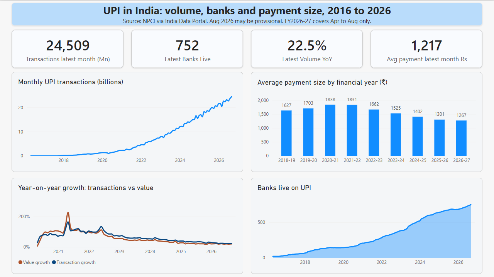

# UPI in India: Volume, Banks and Payment Size (Power BI Dashboard)

## Overview
A one-page Power BI dashboard built on 125 months of official NPCI UPI statistics (April 2016 to August 2026). It shows how fast UPI has grown, how growth is slowing, and how the average payment size has changed.

A PDF export is in `UPI_Dashboard.pdf`. The Power BI file is `upi_dashboard.pbix` (open it with the free Power BI Desktop).

## Data
Source: NPCI UPI Product Statistics, downloaded from the India Data Portal (monthly; number of banks live, volume in millions, value in crore rupees).
The portal lists the dataset with no licence. The raw CSV is not included as a separate file, but the .pbix contains an imported copy of the 125 monthly rows (public NPCI statistics). To refresh, download the CSV from the portal and point the query at it.
125 monthly rows, no missing values.

## Questions answered
1. How fast has UPI grown since launch, and is growth slowing?
2. Is transaction value growing as fast as transaction count?
3. How has the average payment size changed?
4. How many banks are live on UPI?

## Key findings
1. **Volume reached about 24.5 billion transactions in August 2026** (24,509 million), roughly 6.9 times August 2021.
2. **Growth is slowing every year.** Year-on-year transaction growth in January was 74.1% (2023), 51.8% (2024), 39.3% (2025) and 27.7% (2026). August 2026 was 22.5%.
3. **Value grows more slowly than volume.** In August 2026, transactions grew 22.5% and value grew 20.0%. In January 2026 it was 27.7% vs 20.7%.
4. **Average payment size peaked in FY2020-21 and has fallen every year since:** ₹1,838 (FY2020-21), ₹1,662 (FY2022-23), ₹1,402 (FY2024-25), ₹1,301 (FY2025-26), about 29% below the peak. FY2026-27 (April to August only) is ₹1,267. The data shows the decline but not its cause; a plausible explanation (more small payments) would need payment-size data to confirm.
5. **Banks live grew from 21 (2016) to 752 (August 2026).**
6. **April 2021 shows a spike** (+164% volume, +227% value vs April 2020). April 2020 volume was lower than March 2020 (999.6 vs 1,246.8 million), so the comparison base was depressed. I did not test whether lockdowns caused this.

## Method
- **Power Query:** removed the row-id column, renamed columns, set data types, added `Days_In_Month`, `Avg_Daily_Volume_Mn` and `Avg_Ticket_Rs` (value / volume x 10, blank when volume is 0).
- **Calculated columns (DAX):** financial year (April to March), and year-on-year growth for volume and value using `LOOKUPVALUE` with `EOMONTH(date, -12)`.
- **Measures (DAX):** latest-month cards, `Volume (Bn)`, and `Avg Ticket (Rs)` = total value / total volume x 10. It is a weighted average (totals divided by totals), not an average of monthly averages.

## Data notes and limitations
- Units: volume is in millions of transactions; value is in crore rupees (1 crore = 10 million).
- April to June 2016 have zero volume and value; the early months have tiny, rounded values. Growth-rate charts therefore start in April 2020, and the payment-size chart starts in FY2018-19.
- FY2026-27 covers April to August only.
- The latest month (August 2026) may be provisional: the dataset's metadata says last updated 31 July 2026, yet the file includes an August 2026 row.
- NPCI figures can be revised. March 2023 in this file is about 0.4% higher than one published figure.
- Aggregate monthly data only: no per-app, per-bank or per-user detail, so this analysis can describe trends but not explain them.

## Tools
Power BI Desktop, Power Query, DAX.
